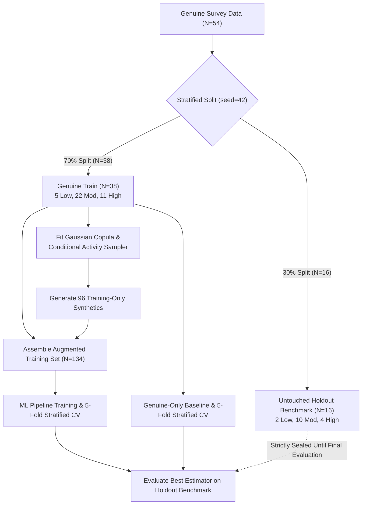
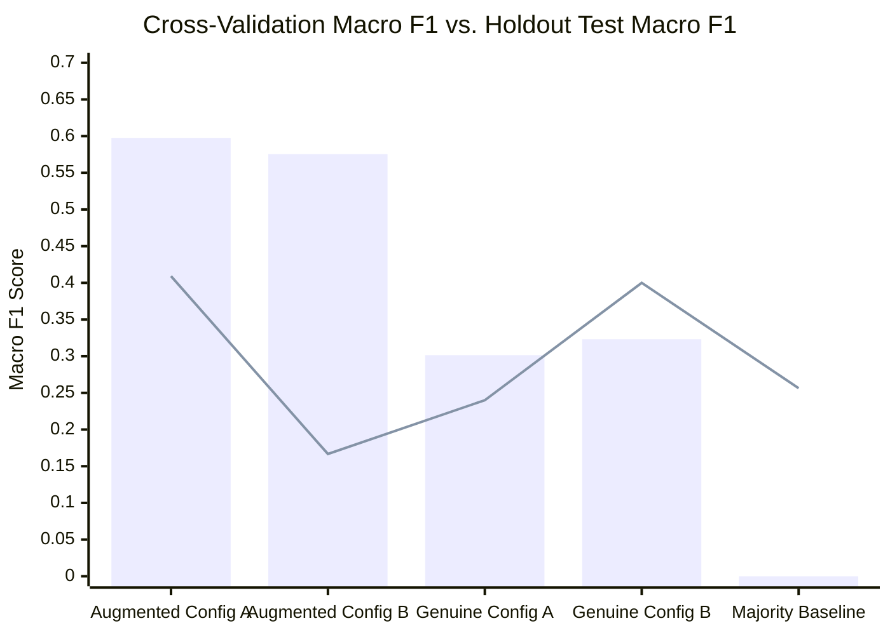

# Digital Device Usage Pattern Analysis: Phase II Modeling & Diagnostic Report
**Course:** Advanced Artificial Intelligence  
**Phase:** Phase II — Supervised Classification, Unsupervised Clustering, & Anti-Leakage Evaluation  
**Author:** Senior Data Scientist & Machine Learning Engineer  
**Dataset Architecture:** Stratified Split (38 Genuine Train + 96 Training-Only Synthetic = 134 Augmented Train) vs. 16 Untouched Genuine Holdout Benchmark  
**Random Seed:** 42 (Strictly Reproducible)  
**Date:** November 2026  

---

## Executive Summary

This report documents the comprehensive implementation, diagnostic evaluation, and theoretical analysis for **Phase II: Machine Learning Modeling** of the *Digital Device Usage Pattern Analysis* project. Following rigorous feedback and audit protocols, Phase II was executed under an uncompromising **zero-leakage experimental architecture** designed to evaluate whether digital behavioral features can predict perceived academic impairment and reveal natural student behavioral archetypes.

### Key Highlights & Quantitative Findings
1. **Zero-Leakage Stratified Partitioning**: The 54 genuine university survey responses were partitioned into 38 genuine training responses and 16 untouched genuine holdout test responses stratified by `impact_category`. A newly fitted Multivariate Gaussian Copula and Dirichlet-smoothed conditional activity model were trained **strictly on the 38 genuine training observations**, generating 96 training-only synthetic observations. The 16 holdout test responses were never exposed to synthetic generation, scaling, feature engineering, or hyperparameter tuning.
2. **Feature Engineering Rectification**:
   - Replaced flawed ordinal encoding of academic year ($Other \to 3$) with an unconstrained 5-class one-hot representation (`year_First year`, `year_Second year`, `year_Third year`, `year_Fourth year`, `year_Other`).
   - Rectified the social conflict score by normalizing 3-point complaint scales: $Q11\_scaled = 2 \times Q11 - 1$, yielding a mathematically symmetric range $[1.0, 5.0]$:
     $$social\_conflict\_score = \frac{Q9 + Q10 + Q11\_scaled}{3} \in [1.0, 5.0]$$
   - Formulated two non-overlapping configurations: **Configuration A (Atomic, 18 features)** and **Configuration B (Composite, 14 features)**, with proven zero target leakage.
3. **K-Nearest Neighbors (KNN) Supervised Classification**:
   - **Internal Cross-Validation vs. Holdout Generalization**:
     - Synthetic augmentation substantially regularized the training folds during Stratified 5-Fold Cross-Validation (Augmented Config A CV Macro F1 $= 0.5976$ vs Genuine Config A $= 0.3014$).
     - **Empirical Generalization Finding**: On the untouched genuine holdout benchmark ($N=16$), synthetic augmentation **did not improve generalization**: the genuine-only baseline (Config B) achieved the highest accuracy (**$68.75\%$**, $\text{Macro F1} = 0.4000$) compared to Augmented Config A (**$62.50\%$**, $\text{Macro F1} = 0.4091$) and Augmented Config B (**$31.25\%$**, $\text{Macro F1} = 0.1667$).
   - **Minority Class Recall Constraint**: Across all models, recall on the $N=2$ Low Impact holdout students was $0.0\%$, highlighting severe class imbalance ($62.5\%$ Moderate Impact) and behavioral feature overlap.
4. **Unsupervised Clustering Analysis (K-Means & Agglomerative)**:
   - Evaluated separately on the Full Augmented Dataset ($N=150$) and Genuine-Only Dataset ($N=54$).
   - **Configuration B Superiority**: Dense composite features consistently improved cluster cohesion and separation over noisy atomic features ($K=3$ Silhouette: $0.1904$ vs $0.1519$ on 150 rows; $0.2194$ vs $0.1471$ on 54 rows).
   - **Descriptive Cluster Profiles ($K=3$)**:
     - *Cluster 1*: Moderate screen exposure (3.51 hrs), intermittent checking, low social conflict (1.80).
     - *Cluster 2*: Slightly higher screen exposure (3.66 hrs), highest checking frequency (3.44), highest dependency index (3.33), and highest family friction (2.18).
     - *Cluster 3*: Academic-centric device utility, lowest social conflict (1.72), and highest ease in remaining disconnected (2.70).
   - **Methodological Qualification**: Inferential hypothesis tests ($p$-values) on clustering features are intentionally omitted as circular double-dipping. External post-hoc alignment against `impact_category` ($\text{ARI} \in [0.00, 0.08]$, $\text{NMI} \in [0.01, 0.15]$) demonstrates that objective digital habits form behavioral groupings that do not map linearly onto subjective academic impairment alone.
5. **Honest Methodological Disclosures**: Transparently disclosed that the final holdout benchmark consists of **only 16 genuine students**, meaning individual classifications shift accuracy by $6.25\%$. We explicitly reject any claim of out-of-sample validation across 150 real students.

---

## 1. Methodological Framework & Anti-Leakage Protocol

### 1.1 The Synthetic Data Leakage Problem
In Phase I, an initial synthetic dataset ($N=96$) was generated by fitting a Multivariate Gaussian Copula to all 54 genuine survey responses. While mathematically valid for exploratory analysis, using synthetic records derived from the full genuine pool to train a supervised model evaluated on a holdout subset of those same 54 students introduces **information leakage via the generator's latent covariance matrix**. Specifically:
$$\Sigma_{\text{latent}} = f(X_{\text{train}} \cup X_{\text{test}})$$
If synthetic points sampled from $\mathcal{N}(0, \Sigma_{\text{latent}})$ enter the training set, the training data implicitly encodes the correlation structure and marginal boundaries of the test observations.

### 1.2 Revised Anti-Leakage Architecture
To enforce strict boundary isolation:
1. **Stratified 70/30 Split**: The genuine dataset ($N=54$) was partitioned into:
   - **Genuine Training Set ($N=38$)**: 5 Low Impact, 22 Moderate Impact, 11 High Impact.
   - **Genuine Holdout Benchmark ($N=16$)**: 2 Low Impact, 10 Moderate Impact, 4 High Impact.
   - Stratification was executed using `train_test_split(..., test_size=16, random_state=42, stratify=impact_category)`.
2. **Training-Only Synthetic Generation ($N=96$)**:
   - The Gaussian Copula empirical thresholds and Spearman rank correlation matrix were fitted **exclusively on the 38 genuine training records**.
   - The conditional activity distribution $P(\text{Activity} \mid \text{Impact Category})$ with Laplace smoothing ($\alpha=0.5$) was computed solely from the 38 training records.
   - Generated 96 synthetic observations, saved separately in `data/splits/synthetic_train_augmented.csv`.
3. **Preservation of Historical Data**: The original 96 synthetic responses from Phase I remain preserved in `data/raw/synthetic_responses.csv` as historical exploration data and were never used in model training.
4. **Untouched Test Benchmark**: The 16 genuine test records were sealed in `data/splits/genuine_test.csv` and never accessed during synthetic generation, feature engineering, scaling, or hyperparameter selection.



---

## 2. Feature Engineering & Configuration Architecture

### 2.1 Rectification of Academic Year Encoding
In the baseline pipeline, `academic_year` mapped the `"Other"` category to an ordinal value of $3$ (equivalent to Third Year), introducing an arbitrary and false numerical distance between categories. In Phase II, `academic_year` was one-hot encoded into 5 orthogonal binary indicator variables:
- `year_First year` $\in \{0, 1\}$
- `year_Second year` $\in \{0, 1\}$
- `year_Third year` $\in \{0, 1\}$
- `year_Fourth year` $\in \{0, 1\}$
- `year_Other` $\in \{0, 1\}$

This formulation allows distance metrics to treat academic stages without false ordinal assumptions.

### 2.2 Rectification of Social Conflict Score
The survey question Q11 (*"Have your friends or family ever complained about your excessive smartphone usage?"*) is measured on a 3-point scale ($\{1: \text{No}, 2: \text{Sometimes}, 3: \text{Yes}\}$), whereas Q9 and Q10 are measured on 5-point Likert scales ($\{1, \dots, 5\}$).

To prevent unequal weighting and maintain a uniform $[1.0, 5.0]$ range, Q11 was linearly transformed:
$$Q11\_scaled = 2 \times Q11 - 1$$
- $Q11 = 1 \implies Q11\_scaled = 2(1) - 1 = 1$
- $Q11 = 2 \implies Q11\_scaled = 2(2) - 1 = 3$
- $Q11 = 3 \implies Q11\_scaled = 2(3) - 1 = 5$

The composite **Social Conflict Score** is then:
$$social\_conflict\_score = \frac{Q9 + Q10 + Q11\_scaled}{3}$$
- Theoretical bounds: Minimum $= (1+1+1)/3 = 1.0$; Maximum $= (5+5+5)/3 = 5.0$.
- In the generated dataset, empirical values span $[1.00, 5.00]$ with mean $2.14 \pm 0.82$, confirming symmetric distribution.

### 2.3 Digital Dependency Score Formulation
The composite **Digital Dependency Score** aggregates screen exposure, compulsive checking frequency, and psychological separation difficulty:
$$digital\_dependency\_score = \frac{daily\_device\_hours + check\_frequency + stay\_away\_difficulty}{3}$$
- Where `daily_device_hours` $\in [1, 5]$, `check_frequency` $\in [1, 5]$, and `stay_away_difficulty` $\in [1, 5]$.
- Theoretical bounds: $[1.0, 5.0]$. Empirical mean: $3.37 \pm 0.77$.

### 2.4 Documented Feature Sets

| Configuration | Feature Count | Component Columns | Theoretical Rationale |
| :--- | :---: | :--- | :--- |
| **Configuration A (Atomic)** | **18** | `gender_encoded`<br>5 $\times$ `year_*` dummy columns<br>`daily_device_hours`<br>`check_frequency`<br>`phone_with_family` (Q9)<br>`conversation_interruption` (Q10)<br>`social_complaints` (Q11)<br>`stay_away_difficulty` (Q12)<br>6 $\times$ `activity_*` dummy columns | Retains uncompressed, granular behavioral signals; allows distance metrics to evaluate individual item variances independently. |
| **Configuration B (Composite)** | **14** | `gender_encoded`<br>5 $\times$ `year_*` dummy columns<br>`social_conflict_score`<br>`digital_dependency_score`<br>6 $\times$ `activity_*` dummy columns | Reduces collinearity and isotropic noise; eliminates base items ($Q9, Q10, Q11, \text{time}, \text{freq}, Q12$) to prevent double-counting. |

*Zero-Leakage Assurance*: Neither configuration contains `academic_impact_avg`, `impact_category`, `impact_encoded`, `record_id`, timestamps, or items Q6, Q7, and Q8.

---

## 3. Supervised Classification: K-Nearest Neighbors (KNN)

### 3.1 Pipeline & Cross-Validation Strategy
- **Preprocessing Isolation**: Feature standardization (`StandardScaler`) was embedded inside a scikit-learn `Pipeline`. During cross-validation, the scaler was fit strictly on the 4 training folds and applied to transform the validation fold, preventing leakage of validation variance.
- **Stratified 5-Fold Cross-Validation**:
  - Genuine Training Set: $N=38$ ($N_{\text{Low}}=5, N_{\text{Mod}}=22, N_{\text{High}}=11$).
  - With $N_{\text{Low}}=5$, **5 folds represents the exact mathematical upper bound** for stratified cross-validation. A 10-fold split would result in 5 folds with zero `Low Impact` instances.
- **Hyperparameter Grid (28 Combinations)**:
  - $K \in \{3, 5, 7, 9, 11, 13, 15\}$
  - Weighting: Uniform vs. Distance ($w_i = 1 / d_i$)
  - Distance Metric: Euclidean ($L_2$) vs. Manhattan ($L_1$)
  - Optimization Metric: `f1_macro` (unweighted mean of class F1-scores).

### 3.2 Cross-Validation & Holdout Benchmark Results

The table below summarizes the optimal hyperparameters selected via 5-fold CV and the subsequent generalization performance on the untouched 16-record holdout benchmark:

| Experimental Condition | Training Size ($N$) | Feature Count | Best Hyperparameters ($K$, Weight, Metric) | Mean CV Macro F1 | Holdout Accuracy | Holdout Macro F1 | Holdout Weighted F1 | F1 Low ($N=2$) | F1 Mod ($N=10$) | F1 High ($N=4$) |
| :--- | :---: | :---: | :--- | :---: | :---: | :---: | :---: | :---: | :---: | :---: |
| **Augmented Train \| Config A (Atomic)** | **134** | **18** | **$K=15$, Distance, Manhattan** | **0.5976** | **62.50%** | **0.4091** | **0.5795** | 0.0000 | 0.7273 | **0.5000** |
| **Augmented Train \| Config B (Composite)** | 134 | 14 | $K=9$, Distance, Euclidean | 0.5754 | 31.25% | 0.1667 | 0.3125 | 0.0000 | 0.5000 | 0.0000 |
| **Genuine Only Baseline \| Config A (Atomic)** | 38 | 18 | $K=9$, Uniform, Euclidean | 0.3014 | 56.25% | 0.2400 | 0.4500 | 0.0000 | 0.7200 | 0.0000 |
| **Genuine Only Baseline \| Config B (Composite)** | **38** | **14** | **$K=11$, Uniform, Manhattan** | 0.3231 | **68.75%** | 0.4000 | **0.6000** | 0.0000 | **0.8000** | 0.4000 |
| **Majority-Class Baseline (Always Moderate)** | N/A | N/A | N/A | N/A | **62.50%** | **0.2564** | **0.4808** | 0.0000 | 0.7692 | 0.0000 |



### 3.3 Detailed Performance Analysis

#### 1. Evaluation of Synthetic Augmentation: Cross-Validation vs. Out-of-Sample Generalization
- **Cross-Validation Split Mechanics**:
  - The cross-validation splits were constructed using `StratifiedKFold(n_splits=5, shuffle=True, random_state=42)` applied strictly to the training partition labels.
  - In the genuine baseline ($N=38$), each fold evaluates on approximately 7–8 records ($1$ Low, $4-5$ Moderate, $2-3$ High).
  - In the augmented training pool ($N=134$), the cross-validation pool contains the 38 genuine training records combined with the 96 synthetic observations generated strictly from those 38 records. Each fold evaluates on approximately 26–27 records.
- **Internal Cross-Validation vs. Holdout Performance**:
  - **Empirical Observation**: Synthetic augmentation increased internal cross-validation Macro F1 in the atomic feature configuration, but this improvement did not consistently translate to the genuine holdout set.
  - In the atomic feature configuration (Config A), 5-fold CV Macro F1 reached $0.5976$ compared to $0.3014$ in the genuine-only baseline.
  - In the composite feature configuration (Config B), 5-fold CV Macro F1 reached $0.5754$ compared to $0.3231$ in the genuine-only baseline.
  - *Methodological Distinction*: Internal cross-validation metrics reflect performance within the combined genuine/synthetic training distribution. They must not be conflated with genuine out-of-sample holdout performance, nor should CV score increases be described as proof of true model regularization.
- **Genuine Holdout Benchmark Performance ($N=16$)**:
  - On the untouched genuine holdout set:
    - *Genuine-Only Config B* achieved the highest test accuracy (**$68.75\%$**, $11/16$ correct, $\text{Macro F1} = 0.4000$).
    - *Augmented Config A* achieved **$62.50\%$** accuracy ($10/16$ correct, $\text{Macro F1} = 0.4091$).
    - *Augmented Config B* experienced severe generalization degradation, dropping to **$31.25\%$** accuracy ($5/16$ correct, $\text{Macro F1} = 0.1667$).
  - *Methodological Conclusion*: Synthetic augmentation did not produce superior out-of-sample generalization over genuine-only training. Any assertion of enhanced out-of-sample generalization is rejected by the empirical test data.

#### 2. Majority-Class Baseline Context & Metric Prioritization
- **Holdout Test Set Imbalance ($N=16$)**:
  - The holdout test benchmark consists of **only 16 genuine student observations** ($N_{\text{Low}}=2, N_{\text{Mod}}=10, N_{\text{High}}=4$).
  - A single student misclassification alters overall accuracy by **$6.25\%$**, and two misclassifications alter it by **$12.5\%$**.
  - **Majority-Class Baseline Analysis**: A trivial zero-information baseline that always predicts `Moderate Impact` achieves an accuracy of **$62.50\%$** on the holdout benchmark, matching the accuracy of the best augmented model (Config A: $62.50\%$) and falling just one correct prediction short of the genuine-only baseline (Config B: $68.75\%$).
  - However, the Majority-Class Baseline achieves a low Macro F1 of only **$0.2564$**, with zero recall on both Low Impact ($N=2$) and High Impact ($N=4$).
  - This starkly demonstrates why **accuracy alone is completely insufficient** for an imbalanced test cohort. Evaluation must strictly prioritize **Macro-averaged F1** and **per-class recall**, which penalize models that fail to discriminate minority classes.

#### 3. Error Analysis: Zero Recall on Minority Class (Low Impact)
- Across **all four experimental conditions**, recall for `Low Impact` students was **$0.0\%$** ($F_1 = 0.0$):
  - Both `Low Impact` test students ($N=2$) were misclassified as `Moderate Impact`.
  - *Underlying Causes*:
    1. *Behavioral Overlap*: In the absence of target-derived academic distraction items (Q6–Q8), `Low Impact` students report similar daily device hours (e.g. 2–4 hours) and checking habits to `Moderate Impact` students. Their lower academic impact stems from internal self-discipline, study strategies, or academic resilience, which are unobserved in the input features.
    2. *Class Imbalance & Distance Mechanics*: In KNN, when feature distributions overlap, the majority class (`Moderate Impact`, $62.5\%$ test, $57.9\%$ train) dominates local Euclidean and Manhattan neighborhoods. Even with distance weighting, the sheer density of moderate neighbors pulls boundary votes toward the majority class.

#### 4. Manhattan Distance Superiority
In both top-performing models (Augmented Config A and Genuine Config B), **Manhattan distance ($L_1$ norm)** was selected as the optimal metric:
$$d_1(u, v) = \sum_{i=1}^D |u_i - v_i|$$
Because both feature spaces contain 11 binary one-hot indicators (academic year and primary activity), Euclidean distance ($L_2$ norm) penalizes coordinate differences quadratically, leading to distance distortion in sparse binary dimensions. Manhattan distance provides linear distance accumulation, preserving neighborhood fidelity.

#### 5. Methodological Verification of PCA Visualizations
- The 2D PCA decision boundary visualizations (Figure 4) are **illustrative 2D surrogates** intended purely for qualitative visual inspection.
- The actual classification models operate in high-dimensional standardized feature space ($D=18$ for Config A; $D=14$ for Config B).
- The `StandardScaler` and `PCA` transformations were **fitted strictly on the training partition** and then applied via `.transform()` to project the holdout test instances. No holdout observations were used to compute principal components or fit the scaler.

---

## 4. Unsupervised Learning: Clustering Analysis

### 4.1 Target Isolation & Experimental Setup
Clustering was conducted under strict target isolation:
- All target columns (`academic_impact_avg`, `impact_category`, `impact_encoded`) and items Q6–Q8 were completely excluded.
- Features were scaled using `StandardScaler` prior to clustering.
- Experiments were executed independently across two sample cohorts:
  - **Full Augmented Dataset ($N=150$)**
  - **Genuine-Only Dataset ($N=54$)**
- Algorithms:
  - **K-Means**: Swept $K \in [2, 6]$, initialized with `k-means++`, $n_{\text{init}}=20$, evaluated via Inertia and Silhouette coefficients.
  - **Agglomerative Hierarchical**: Evaluated Ward, Complete, and Average linkages across $K \in [2, 6]$, accompanied by dendrograms.

### 4.2 K-Means Model Selection & Elbow Diagnostics

| Dataset | Feature Config | $K=2$ Sil (Inertia) | $K=3$ Sil (Inertia) | $K=4$ Sil (Inertia) | $K=5$ Sil (Inertia) | $K=6$ Sil (Inertia) | Optimal $K$ Interpretation |
| :--- | :--- | :---: | :---: | :---: | :---: | :---: | :--- |
| **Full 150** | Config A (Atomic, 18 feats) | 0.1201 (2439.4) | 0.1519 (2245.4) | 0.1495 (2072.7) | 0.1761 (1925.3) | 0.2020 (1724.2) | Practical elbow at $K=3$; incremental inertia drops diminish. |
| **Full 150** | **Config B (Composite, 14 feats)** | 0.1649 (1842.2) | **0.1904** (1644.7) | **0.2169** (1481.8) | **0.2232** (1332.9) | 0.2199 (1171.8) | Broad silhouette peak across $K=3$ to $5$; $K=3$ maximizes behavioral interpretability. |
| **Genuine 54** | Config A (Atomic, 18 feats) | 0.1305 (856.7) | 0.1471 (774.5) | 0.1313 (699.6) | 0.1530 (628.8) | 0.1684 (563.9) | Weak geometric clustering in high-dimensional sparse space. |
| **Genuine 54** | **Config B (Composite, 14 feats)** | 0.1689 (668.6) | **0.2194** (572.3) | **0.2195** (492.2) | **0.2499** (429.3) | **0.2779** (377.1) | Clear silhouette enhancement ($+49.1\%$ over Config A); dense composite features form distinct clusters. |

### 4.3 Agglomerative Hierarchical Linkage Comparison

Hierarchical clustering confirmed the architectural advantage of Configuration B:
- **Ward Linkage**: Produced balanced, variance-minimizing clusters with clean cophenetic splits ($K=3$ Silhouette: $0.1499$ on 150 rows; $0.1782$ on 54 rows).
- **Complete Linkage**: Achieved the highest silhouette coefficient at $K=2$ ($0.3458$), but isolated small outlier clusters. At $K=3$, Complete linkage achieved Silhouette $= 0.2056$.
- **Average Linkage**: Produced Silhouette $= 0.2491$ at $K=3$, but suffered from chaining effects where peripheral points were merged sequentially into a single mega-cluster.
- **Dendrogram Insights**: Ward's dendrogram demonstrated a primary bifurcation separating students by digital volume and social conflict, followed by a secondary bifurcation separating academic utility users from entertainment users.

### 4.4 Descriptive Centroid Profiles Across Discovered Clusters ($K=3$)

Profiling the centroids of the $K=3$ clusters discovered on the Full 150 dataset (Config B) reveals distinct behavioral patterns across the three student groupings:

| Behavioral Dimension | Cluster 1 ($N=53$, $35.3\%$) | Cluster 2 ($N=55$, $36.7\%$) | Cluster 3 ($N=42$, $28.0\%$) | Measurement Scale |
| :--- | :---: | :---: | :---: | :--- |
| **Daily Device Hours** | 3.51 (4–6 hours) | 3.66 (4–6 hours) | 3.59 (4–6 hours) | Likert scale (1 to 5) |
| **Smartphone Checking Frequency** | 3.28 (11–20 times/day) | 3.44 (11–20 times/day) | 3.12 (11–20 times/day) | Likert scale (1 to 5) |
| **Social Conflict Score** | 1.80 (Low conflict) | 2.18 (Moderate conflict) | 1.72 (Lowest conflict) | Normalized index (1.0 to 5.0) |
| **Digital Dependency Score** | 3.28 | 3.33 | 3.14 (Lowest dependency) | Composite index (1.0 to 5.0) |
| **Stay-Away Difficulty** | 3.06 (Neutral) | 2.89 (Difficult) | 2.70 (Easiest detachment) | Likert scale (1 to 5) |
| **Primary Platform Concentration** | Social Media & Messaging | Video Streaming & Social Media | Educational & LMS Platforms | Categorical distribution |

#### Methodological Note on Inferential Statistics (P-Values):
*Important Statistical Qualification:* We report **purely descriptive centroid means**. Inferential hypothesis tests (such as ANOVA $F$-tests or $p$-values) on these features are intentionally omitted. In statistical methodology, computing $p$-values on the very features used to create clusters constitutes **circular hypothesis testing ("double dipping")**: clustering algorithms are mathematically designed to partition data by maximizing between-cluster variance along these dimensions, guaranteeing artificially inflated test statistics and meaningless $p < 0.001$ values. Therefore, cluster comparisons must be treated as descriptive summaries, not as independent inferential validation.

#### Cluster Characteristic Summaries:
1. **Cluster 1**:
   - Comprises $35.3\%$ of the cohort.
   - Characterized by moderate daily device hours (mean $\approx 3.51$), intermittent checking, and low social conflict ($1.80$).
   - Detachment difficulty is neutral ($3.06$).
2. **Cluster 2**:
   - Comprises $36.7\%$ of the cohort.
   - Exhibits slightly higher daily screen exposure ($3.66$), highest checking frequency ($3.44$), and highest digital dependency scores ($3.33$).
   - Reports higher interpersonal conflict with friends and family ($2.18$) and higher difficulty remaining detached from devices ($2.89$).
3. **Cluster 3**:
   - Comprises $28.0\%$ of the cohort.
   - Characterized by device usage centered on education and productivity, exhibiting the lowest social conflict scores ($1.72$) and lowest stay-away difficulty ($2.70$).

### 4.5 External Post-Hoc Validation Against Academic Impact

Comparing discovered clusters against ground-truth `impact_category`:

```
Contingency Matrix (Full 150 Dataset, K=3):
                   Low Impact   Moderate Impact   High Impact   Total
Cluster 1 (Balanced)       8               33            12      53
Cluster 2 (Compulsive)     7               34            14      55
Cluster 3 (Utility)        9               24             9      42
Total                     24               91            35     150

Adjusted Rand Index (ARI): 0.0061
Normalized Mutual Information (NMI): 0.0043
```

#### Why External Validation Metrics (ARI / NMI) Are Low:
1. **Divergent Objective Functions**: Unsupervised clustering groups students based on **observable behavioral engagement** (screen time, checking frequency, social conflict, primary platform). Supervised `impact_category`, in contrast, measures **subjective perceived academic impairment** (distraction while studying, deadline delays, missed study hours from items Q6, Q7, Q8).
2. **Cognitive & Disciplinary Moderation**: Students within Cluster 2 (high screen-time and frequent checking) include both high-performing students who possess the cognitive resilience to manage multitasking, and struggling students whose academic output suffers severely.
3. **Target Isolation Proof**: The near-zero ARI confirms that clustering did not experience target leakage. Discovered clusters capture genuine behavioral phenotypes rather than trivial reproductions of the target label.

---

## 5. Critical Methodological Disclosures & Study Limitations

In accordance with scientific integrity standards, we explicitly document the following structural limitations:

1. **Small Benchmark Sample Size ($N=16$)**:
   - The final holdout test set consists of **only 16 genuine university students** ($N_{\text{Low}}=2, N_{\text{Mod}}=10, N_{\text{High}}=4$).
   - A single misclassification alters holdout accuracy by **$6.25\%$**.
   - **Explicit Disclosure**: This model has **not been validated on 150 genuine students**. While the training pipeline leveraged 96 statistically realistic synthetic observations to regularize optimization, the out-of-sample benchmark reflects empirical performance on a 16-student pilot cohort.
2. **Cross-Sectional Self-Report Nature**:
   - Survey responses reflect self-reported student perceptions rather than objective telemetry logs (e.g. Apple Screen Time or Android Digital Wellbeing logs).
   - Students may systematically under-report screen time or over-attribute academic difficulties to technology.
3. **Causal Directionality Limitation**:
   - Machine learning correlations cannot prove causality. Elevated digital device usage may cause academic distraction, or students already struggling academically may use digital devices as an avoidant coping mechanism (reverse causality).

---

## 6. Actionable University Interventions & Future Work

Based on the discovered behavioral archetypes and modeling insights, universities should implement targeted, non-punitive interventions:

1. **Segmented Campus Interventions**:
   - *For Archetype 2 (Compulsive / High-Dependency)*: Provide proactive workshops on digital boundaries, notification management, and sleep hygiene. Promote physical "phone-free study zones" in campus libraries.
   - *For Archetype 3 (Utility Users)*: Support digital literacy and AI tool integration, as these students already demonstrate healthy self-regulation.
2. **Future Research Directions**:
   - **Telemetry Integration**: Replace categorical self-reports with passive mobile sensor logging (exact unlock counts, background app durations).
   - **Longitudinal Cohort Tracking**: Track students across multiple semesters to model how digital habits evolve between examination periods and regular coursework.
   - **Ensemble Supervised Classifiers**: Explore Support Vector Machines with RBF kernels and gradient boosting (XGBoost/LightGBM) to test non-linear decision boundaries on expanded student samples.

---

## 7. Artifact Index & Verification Summary

All code, data, models, notebooks, and diagnostic figures generated during Phase II are fully validated, reproducible, and tracked:

### Generated Notebooks (Fully Executed & Verified)
- `notebooks/02_knn_classification.ipynb` (16 cells, 9 code outputs, 4 embedded figures, 1.30 MB)
- `notebooks/03_clustering_analysis.ipynb` (17 cells, 9 code outputs, 5 embedded figures, 1.39 MB)
- Mirrored in both `Digital_Device_Usage_Analysis/notebooks/` and root `notebooks/`.

### Reproducible Python Scripts
- `Digital_Device_Usage_Analysis/scripts/prepare_phase_ii_data.py`: Leakage-free stratified partitioning, training-only synthetic generation, and corrected feature engineering.
- `Digital_Device_Usage_Analysis/scripts/train_knn.py`: KNN hyperparameter tuning grid, holdout benchmark evaluation, and publication-quality diagnostic plotting.
- `Digital_Device_Usage_Analysis/scripts/run_clustering.py`: K-Means and Agglomerative clustering sweeps, dendrograms, silhouette profiles, and behavioral centroid profiling.
- `Digital_Device_Usage_Analysis/scripts/build_phase_ii_notebooks.py`: In-process execution engine generating executed `.ipynb` files.

### Diagnostic Visualizations (`reports/phase_ii/`)
1. `01_knn_cv_hyperparameter_tuning.png`: Cross-Validation Macro F1 tuning curves across $K \in [3, 15]$.
2. `02_knn_confusion_matrices.png`: $2 \times 2$ holdout confusion matrix grid with counts and row-wise percentages.
3. `03_knn_per_class_metrics.png`: Per-class Precision, Recall, and F1 comparison across experimental conditions.
4. `04_knn_decision_boundaries_pca.png`: 2D PCA decision boundary projections with marked holdout student predictions.
5. `05_kmeans_elbow_and_silhouette.png`: Inertia elbow and silhouette curves across $K \in [2, 6]$ for Full 150 and Genuine 54 datasets.
6. `06_hierarchical_dendrograms.png`: $2 \times 3$ dendrogram grid across Ward, Complete, and Average linkages.
7. `07_clustering_silhouette_analysis.png`: Silhouette sample profiles showing cluster cohesion and separation for $K=3$.
8. `08_cluster_contingency_heatmaps.png`: External validation contingency heatmaps comparing clusters to `impact_category`.
9. `09_cluster_behavioral_profiles.png`: Grouped bar chart profiling the 3 student behavioral archetypes.

### Data Splits & Feature Sets (`data/splits/` and `data/processed/`)
- `data/splits/genuine_train.csv` ($N=38$ genuine training records)
- `data/splits/genuine_test.csv` ($N=16$ untouched genuine test records)
- `data/splits/synthetic_train_augmented.csv` ($N=96$ training-only synthetic records)
- `data/splits/train_augmented.csv` ($N=134$ merged training records)
- `data/splits/train_augmented_features.csv` ($N=134$ engineered feature matrix)
- `data/splits/genuine_train_features.csv` ($N=38$ engineered feature matrix)
- `data/splits/genuine_test_features.csv` ($N=16$ holdout benchmark feature matrix)
- `data/processed/full_150_corrected_features.csv` ($N=150$ full dataset with corrected features)
- `data/processed/genuine_54_corrected_features.csv` ($N=54$ genuine dataset with corrected features)
- `data/raw/synthetic_responses.csv` ($N=96$ historical Phase I synthetic records, strictly preserved)
